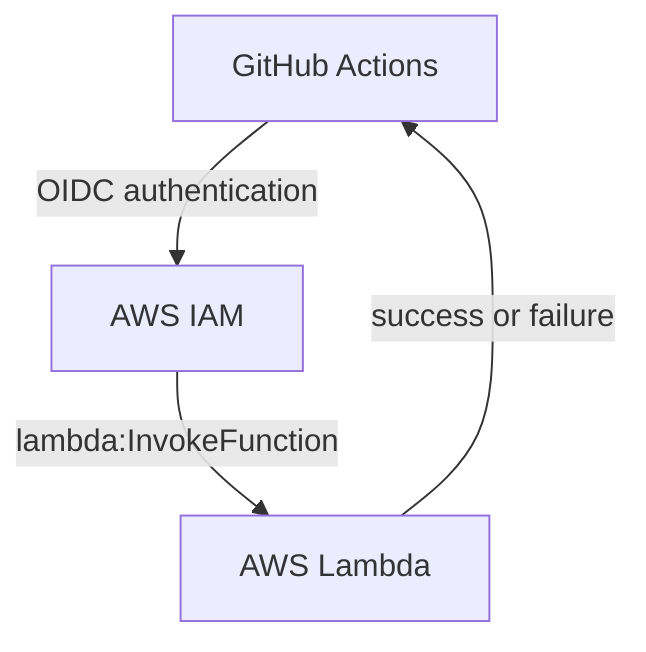
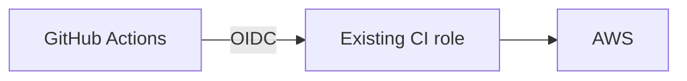
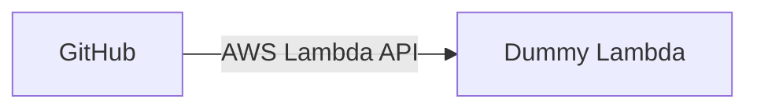

# Plan: Invoke an AWS Lambda from GitHub Actions with OIDC

## Goal

This repository is a small learning project to understand how a GitHub Actions workflow can invoke an AWS Lambda directly using GitHub OIDC authentication.

The motivating use case is a CI pre-deployment check. CI cannot directly access a resource inside a private AWS network, but a Lambda can. CI should invoke the Lambda synchronously and use its execution result to decide whether the pipeline may continue.

The project demonstrates this control flow:



## Scope

Keep the implementation deliberately small:

- Use Terraform for AWS infrastructure.
- Use GitHub OIDC; do not introduce long-lived AWS credentials.
- Reuse an existing personal GitHub OIDC setup if appropriate rather than creating duplicate infrastructure.
- Invoke the Lambda directly through the AWS Lambda API.
- Do not add API Gateway, Lambda Function URLs, SQS, EventBridge, or other Lambda triggers.
- Use least-privilege IAM permissions.
- Ensure the GitHub Actions workflow distinguishes a successful Lambda invocation from a successful Lambda execution.
- Prefer explicit, conventional AWS mechanisms over abstractions.

## Working approach

Implement one step at a time. After each step, explain what changed, why it is needed, and how to verify it before proceeding to the next step.

Do not implement later steps until the current step has been verified.

## Steps

### Step 1 — Inspect only

Inspect the existing Terraform and GitHub Actions configuration. Identify:

- How GitHub Actions currently authenticates to AWS using OIDC.
- Which IAM role it assumes.
- Whether that role could be extended with permission to invoke a Lambda.

Do not modify anything yet. Propose the smallest change.



### Step 2 — Add a dummy Lambda with Terraform

Add the smallest Terraform-managed Node.js Lambda for testing direct invocation. The handler should accept a JSON payload and return it with an `ok: true` result.

Do not add API Gateway, a Function URL, EventBridge, SQS, or other triggers. Invoke this Lambda only through the Lambda Invoke API.



The Lambda must have no trigger configured.

### Step 3 — Allow the existing GitHub OIDC role to invoke only this Lambda

Extend the existing GitHub Actions AWS role with the minimum permission required to invoke this Lambda. Restrict `lambda:InvokeFunction` to this function; do not use `Resource: "*"`.

```text
GitHub OIDC role
  └── lambda:InvokeFunction
        └── Resource: dummy-lambda
```

### Step 4 — Invoke the Lambda from CI

Add a GitHub Actions step to invoke the Lambda:

```yaml
- name: Invoke reconciliation test Lambda
  run: |
    aws lambda invoke \
      --function-name ... \
      --payload '{"hello":"github"}' \
      response.json
```

Run it manually and verify the result follows this flow:

```text
GitHub
  ↓ OIDC authentication
AWS
  ↓ InvokeFunction
Lambda
  ↓ { "ok": true, ... }
```

### Step 5 — Learn the failure behavior

This is the most useful experiment for the actual ticket.

Change the dummy Lambda so the payload can request failure:

| Payload | Lambda behavior | CI result |
| --- | --- | --- |
| `{ "shouldFail": false }` | Lambda succeeds | Green |
| `{ "shouldFail": true }` | Lambda throws | Red |

Make the GitHub Actions step fail when the invoked Lambda reports a function execution error. Do not treat a successful AWS `InvokeFunction` API request as proof that the Lambda handler succeeded.

Test both cases.
